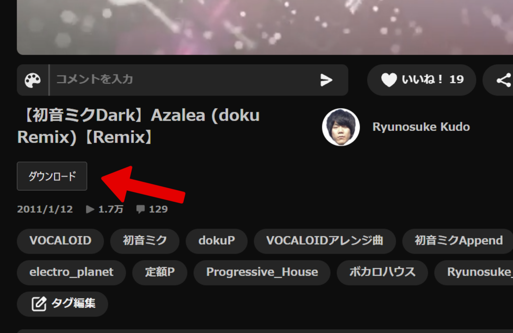
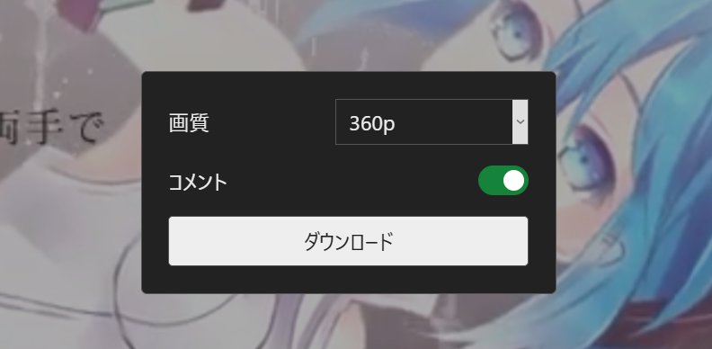

# NicoDrop

ニコニコ動画を、好きな画質・コメントの有無を選んでMP4形式でダウンロードできるChrome拡張機能です。

動画の視聴ページにダウンロードボタンを追加し、サイト上から簡単に保存できます。

## インストール

1. GitHubの「Code」→「Download ZIP」からダウンロードし、ZIPを展開します。
2. Chromeで `chrome://extensions` を開き、デベロッパーモードをONにします。
3. 「パッケージ化されていない拡張機能を読み込む」で、展開した `NicoDrop-main` フォルダ内の `dist` を選択します。
4. 開いているニコニコ動画のページを再読み込みします。

ビルドは不要です。ソースを変更する場合は、Node.js 22以降で `npm ci` → `npm run build` を実行してください。

## 使い方

1. ニコニコ動画の視聴ページの動画の下にある「ダウンロード」ボタンを押します。

   

2. 画質を選び、必要ならコメントをONにします。

   

3. 「ダウンロード」を押し、表示される保存ダイアログで保存先を選びます。動画タイトルのMP4が保存されます。
4. 中断するときは「キャンセル」を押します。

コメントのスイッチは緑がON、グレーがOFFです。操作画面を閉じても、ダウンロードは継続します。ボタンを再度押すと進捗画面を開けます。

保存が終わるまで視聴ページを開いておいてください。動画切り替え・ページ移動・タブを閉じる操作で処理を中断します。

コメントONの変換には時間がかかります。旧DMC・DRM・ライブ配信には対応していません。

---
# English

NicoDrop is a Chrome extension that lets you download NicoNico videos as MP4 files, with selectable video quality and optional comments.

It adds a download button directly to NicoNico video pages, making it easy to save videos without leaving the site.

## Installation

1. Select **Code → Download ZIP** on GitHub and extract the ZIP file.
2. Open `chrome://extensions` in Chrome and enable **Developer mode**.
3. Click **Load unpacked** and select the `dist` folder inside the extracted `NicoDrop-main` folder.
4. Reload any open NicoNico video pages.

No build is required to install. To rebuild after editing the source, use Node.js 22 or later and run `npm ci` followed by `npm run build`.

## Usage

1. Click the **Download** button below the video on a NicoNico watch page.

   

2. Select your preferred video quality and enable comments if desired.

   

3. Click **Download** and choose a save location in the dialog. The video will be saved as an MP4 file using its title as the filename.
4. To stop the download, click **Cancel**.

The comments toggle is green when enabled and gray when disabled. Downloads continue even if you close the download panel. Click the button again to view the progress.

Keep the video page open until the download is complete. Switching videos, navigating away, or closing the tab will interrupt the process.

Processing videos with comments enabled may take longer. Legacy DMC, DRM-protected content, and live streams are not supported.
